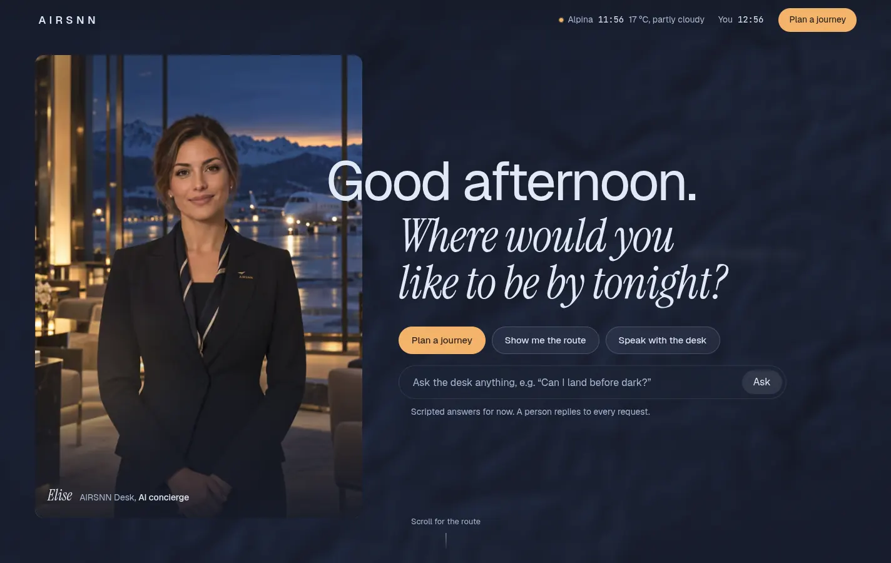
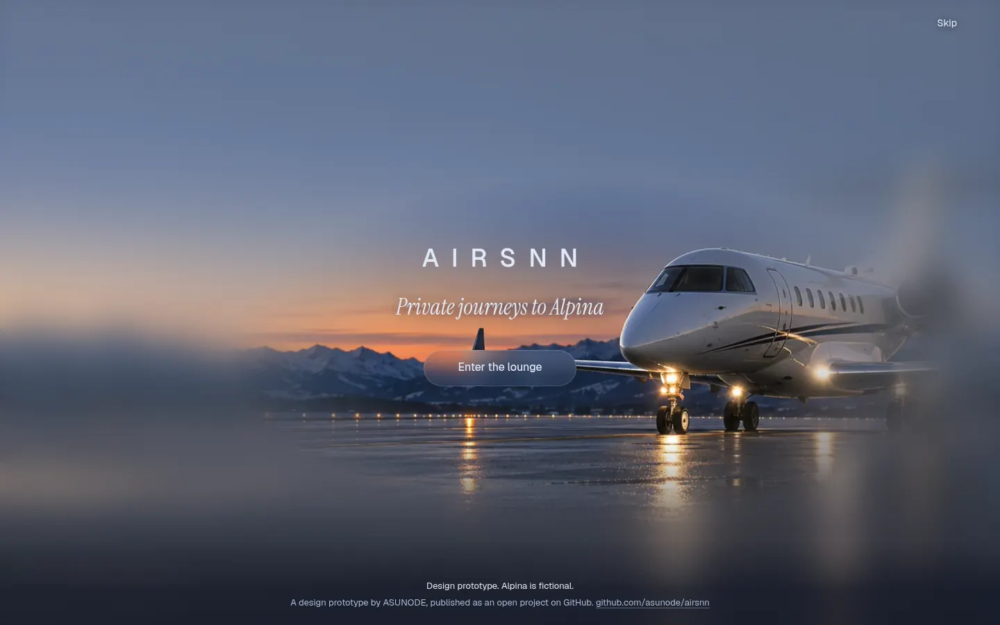
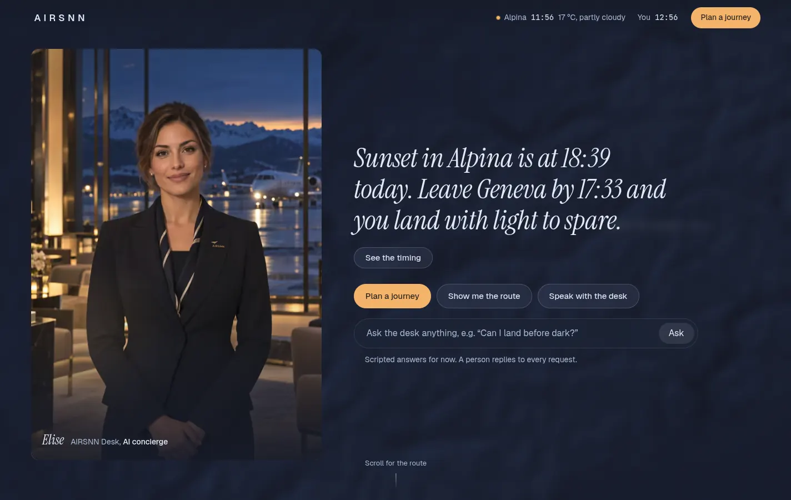
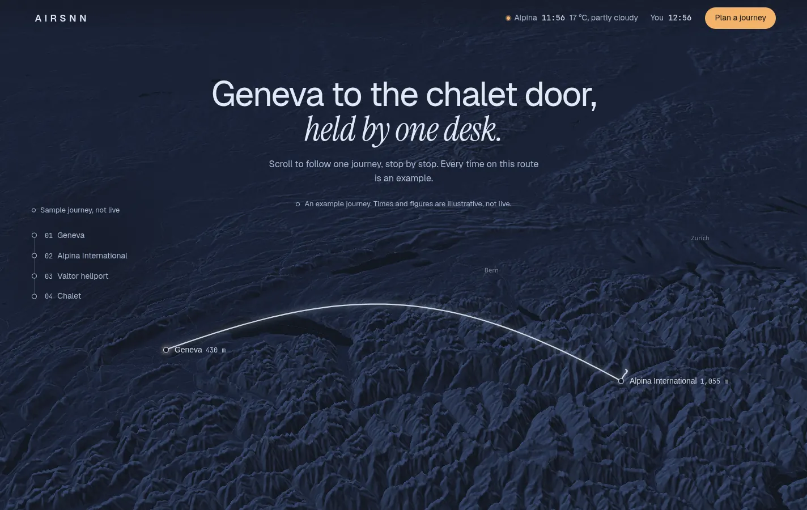
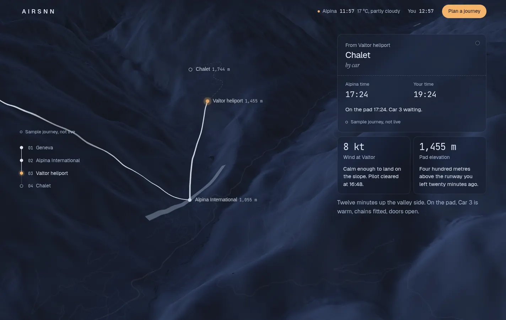
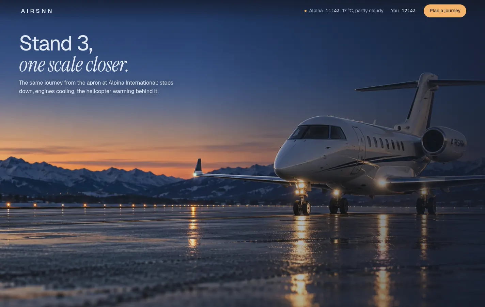
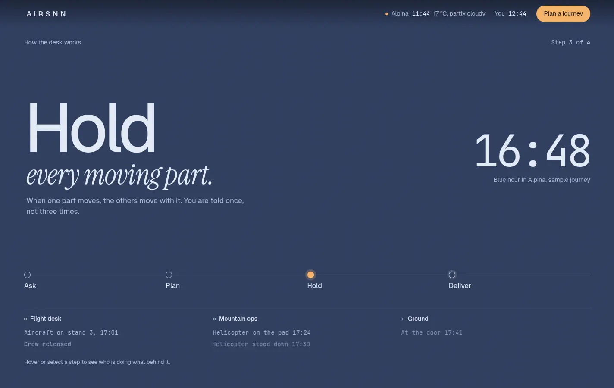
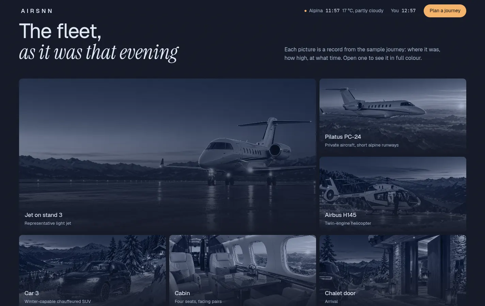
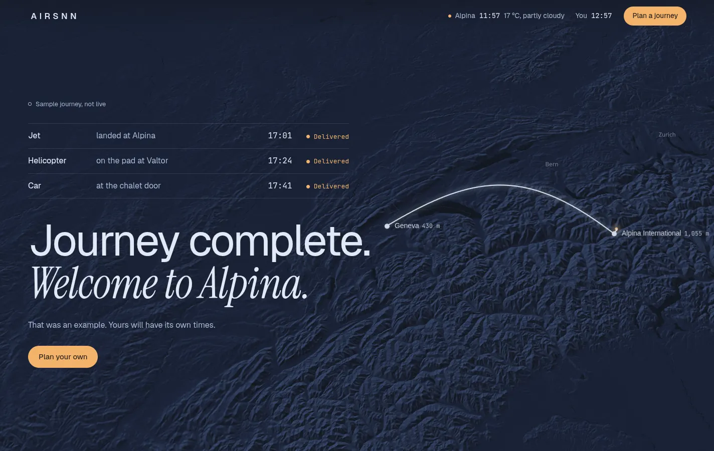
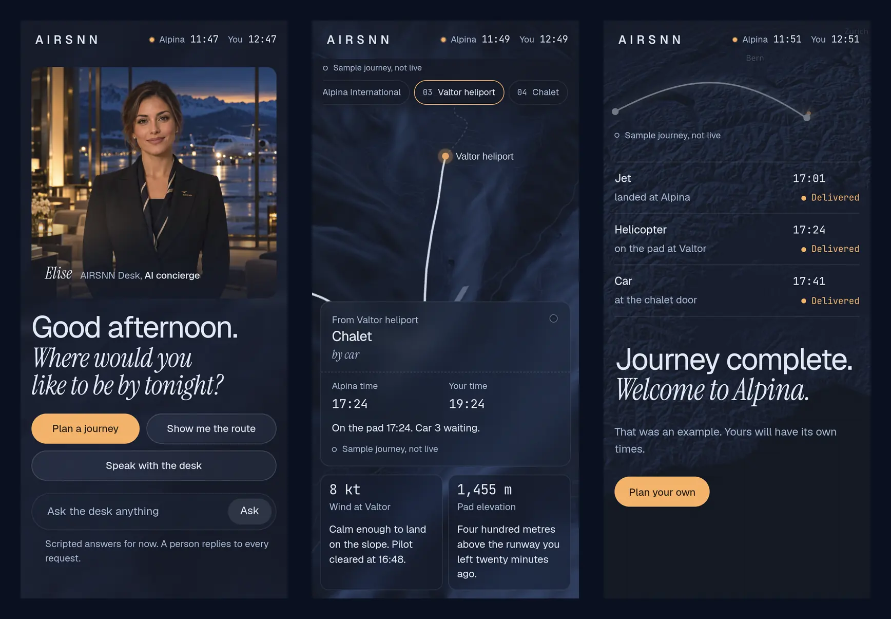

# AIRSNN

A design prototype for a private-travel concierge: one evening journey from Geneva to a chalet door in the fictional Alpine resort of Alpina, told as a single scrolling place.



## The idea

The site is not a page; it is a place and a journey. You come in through the door of a lounge, a concierge at the desk asks where you would like to be tonight, and behind the desk a dark map of the Alps holds the whole journey: jet, helicopter, car, one plan, one team. In front, a person (clearly an AI concierge); behind, a flawless system. The site shows this rather than saying it.

The full design direction is in [`docs/design-direction.md`](docs/design-direction.md).

## The flow


*The door. Fogged lounge glass that clears on the first visit only.*


*Ask the desk. The answer becomes the headline, using today's real sunset at Alpina.*


*The whole route over 3D Alps. Scrolling moves the camera stop by stop.*


*A stop. Luggage-tag card, Alpina time next to yours, every number with a sentence.*


*One scale closer. From the map to the jet on the apron, then into the cabin.*


*How it works. Ask, Plan, Hold, Deliver, with the light of the day changing behind.*


*The fleet as records. Muted in the grid, full colour with altitude, time and route when opened.*


*Arrival. Each leg turns "Delivered", then the camera pulls back to the whole route.*


*On a phone (390 px). Cards become a bottom drawer, the route rail a row of chips.*

## Honest by design

- **Alpina is fictional.** So are Alpina International, Valtor and the chalet. They sit at chosen coordinates on the real Alps.
- **The images are AI-generated**, including the concierge's portrait and every aircraft, car and room.
- **The journey is a sample.** Every time and figure on the route is illustrative and labelled "Sample journey, not live".
- **Only two things are live:** the Alpina clock and the Alpina weather (with today's sunset).
- **The concierge is an AI** and is labelled "AI concierge" wherever it appears. Its answers are scripted for now.
- **The plan form sends nothing.** Nothing you type leaves the page.

## How it's built

- Plain HTML, CSS and JavaScript (ES modules). No framework, no build step.
- [MapLibre GL JS](https://maplibre.org) with [OpenFreeMap](https://openfreemap.org) vector tiles, a custom dark style, hillshade and 3D terrain from Mapzen terrain tiles.
- Live weather and sunset from [Open-Meteo](https://open-meteo.com), with no API key and a 15-minute cache.
- Self-hosted fonts: Geist, Instrument Serif, JetBrains Mono.
- All content comes from three JSON files in `site/data/`: the sample journey, the desk's scripted answers and site settings.
- Accessibility and performance: AA contrast throughout, `prefers-reduced-motion` respected, keyboard navigation. Mobile LCP is about 0.8 s (Fast 4G, 4× CPU, local server) with a CLS of 0.

## Run locally

The site uses `fetch`, so it needs a local server; opening `index.html` as a file won't work.

```bash
cd site
python3 -m http.server 8000
```

Then open <http://localhost:8000>. Useful options: `?gate=1` shows the entrance again, `?hold` stops it from opening by itself.

## How it was made

The prototype was built with [Claude Code](https://claude.com/claude-code), using the Chrome DevTools MCP to drive and measure the page and the frontend-design skill for the visual direction. The process was:

1. Analyse five reference sites.
2. Write a design direction document, now in [`docs/design-direction.md`](docs/design-direction.md).
3. Build the prototype flow scene by scene, with screenshots at 1440 and 390 px and measurements (contrast, LCP, CLS, console) in every round.

## Live demo

Coming soon at <https://asunode.github.io/airsnn/>.

## Status

Design prototype (v2). Not a product, and nothing can be booked.

## Credits and licenses

- **Code:** MIT, © ASUNODE. See [`LICENSE`](LICENSE).
- **Images, written content and the AIRSNN name and mark:** © ASUNODE, all rights reserved. These are not covered by the MIT license; see [`NOTICE.md`](NOTICE.md).
- **Fonts:** Geist, Instrument Serif and JetBrains Mono, under the SIL Open Font License 1.1. License files are in `site/fonts/licenses/`.
- **Map:** MapLibre GL JS (BSD-3-Clause). Map data © OpenStreetMap contributors, © OpenMapTiles, served by OpenFreeMap. Terrain from Mapzen / AWS Terrain Tiles.
- **Weather:** Open-Meteo (CC BY 4.0).

Map attribution is shown on the map itself and in the site footer.
